# React Performance

#### Initial performance

Commit Duration
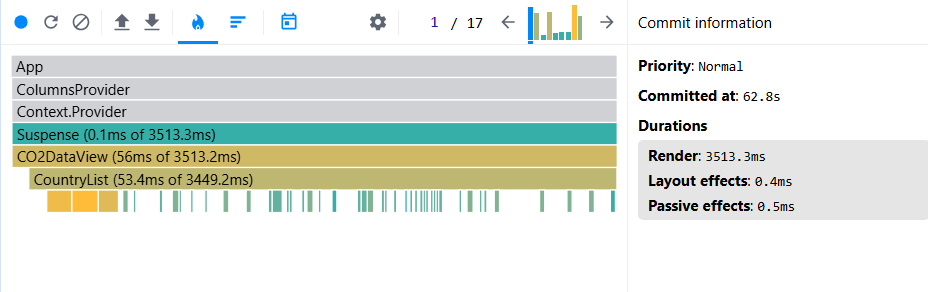
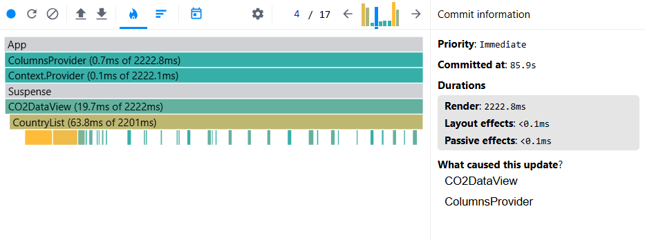

Flame Graph and Render Duration
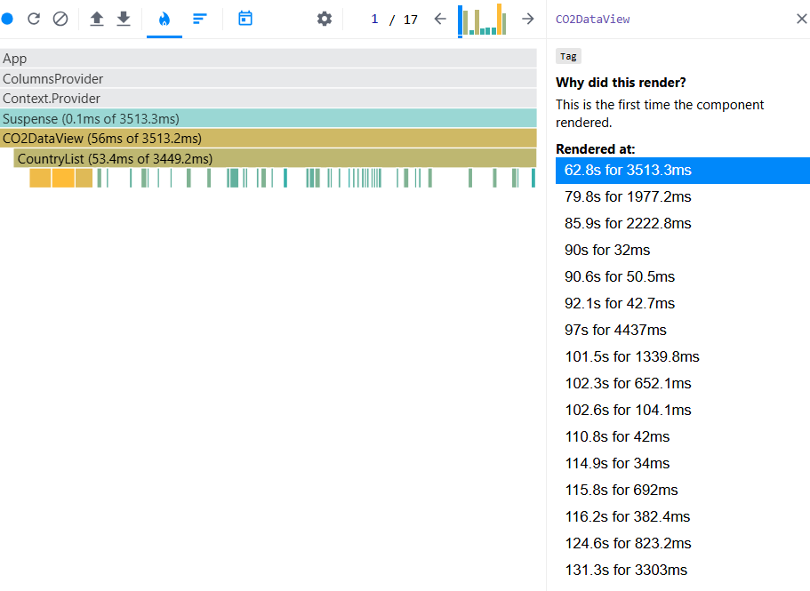

Ranked Chart
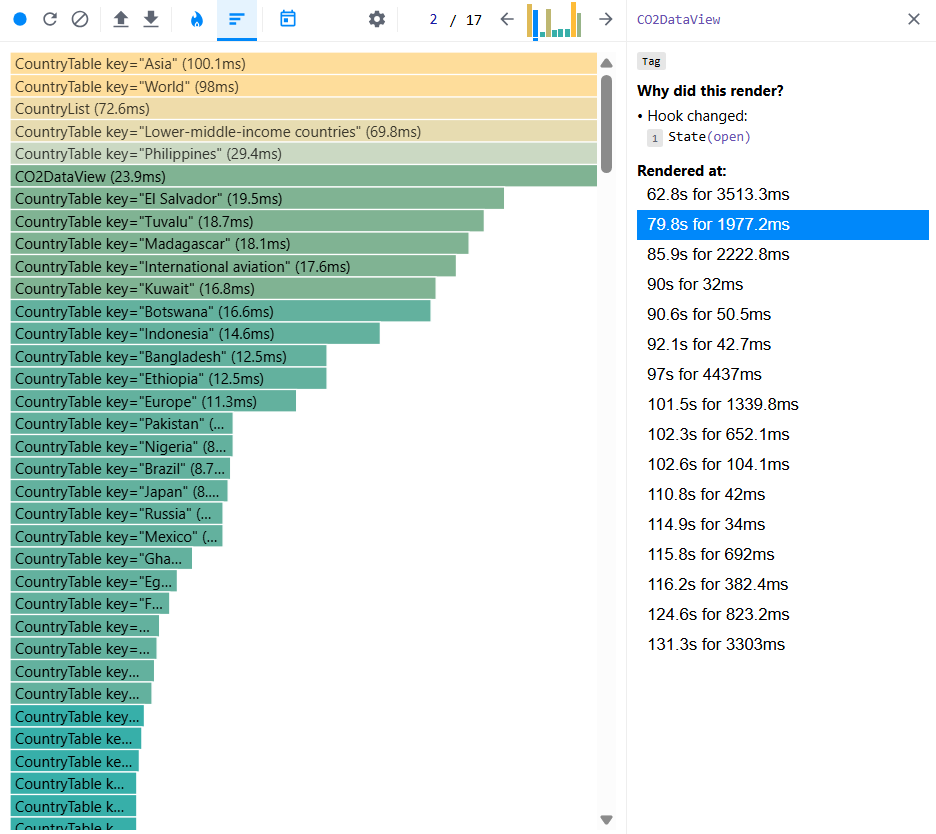

#### After splitting CO2DataView into separate components, performance deteriorated and loading time increased

Commit Duration
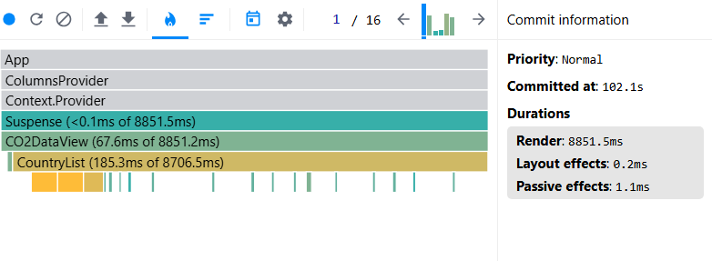
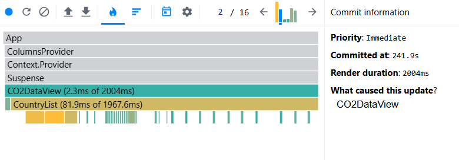

Flame Graph and Render Duration
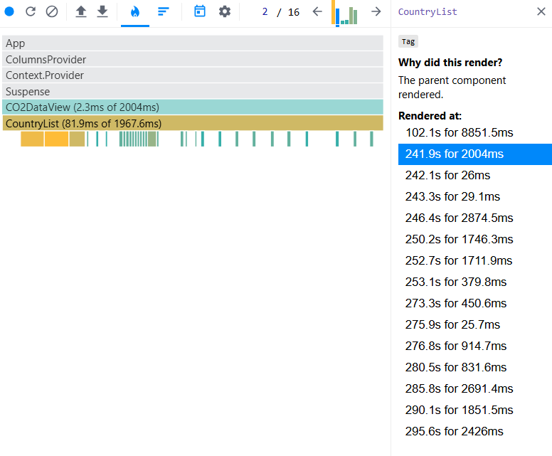

Ranked Chart
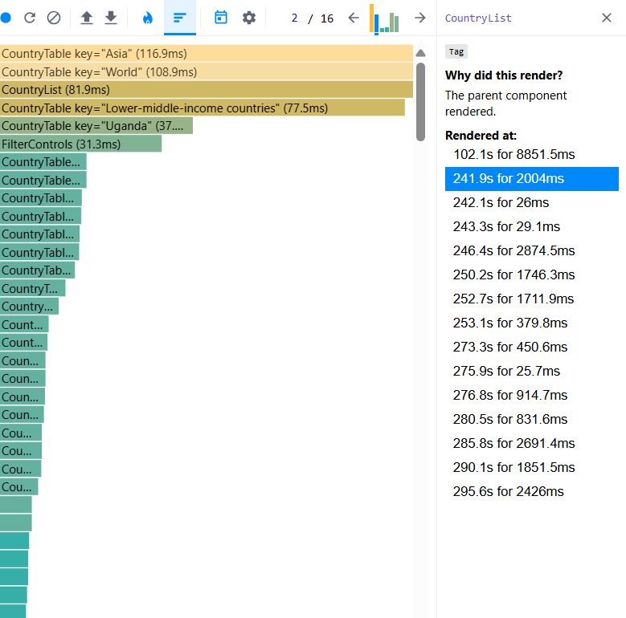

#### After adding React.memo to CountryList and CountryTable, performance improved, loading time decreased

Commit Duration
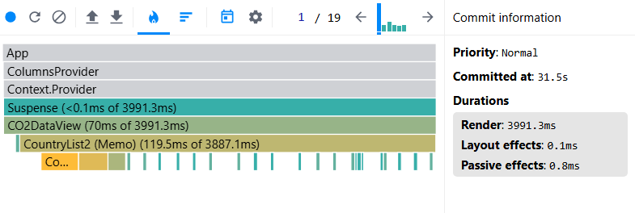
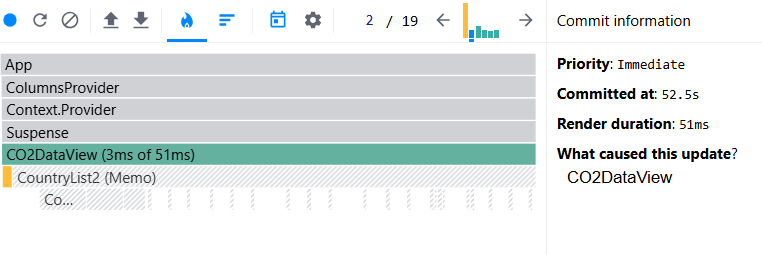

Flame Graph and Render Duration
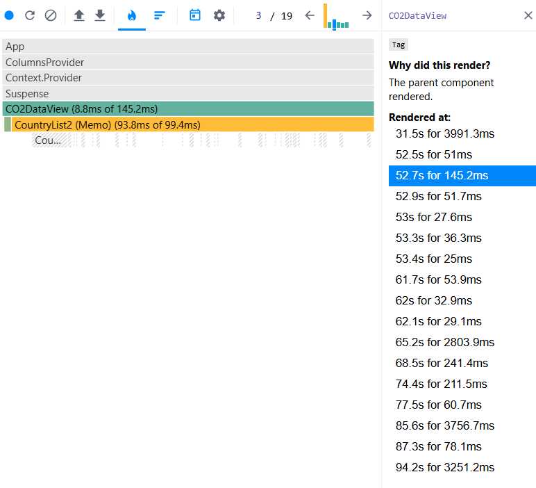

Ranked Chart
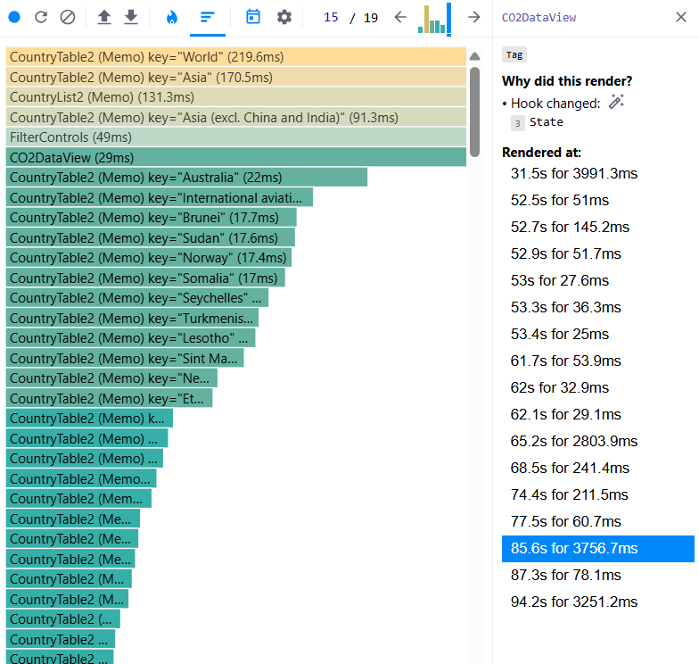
